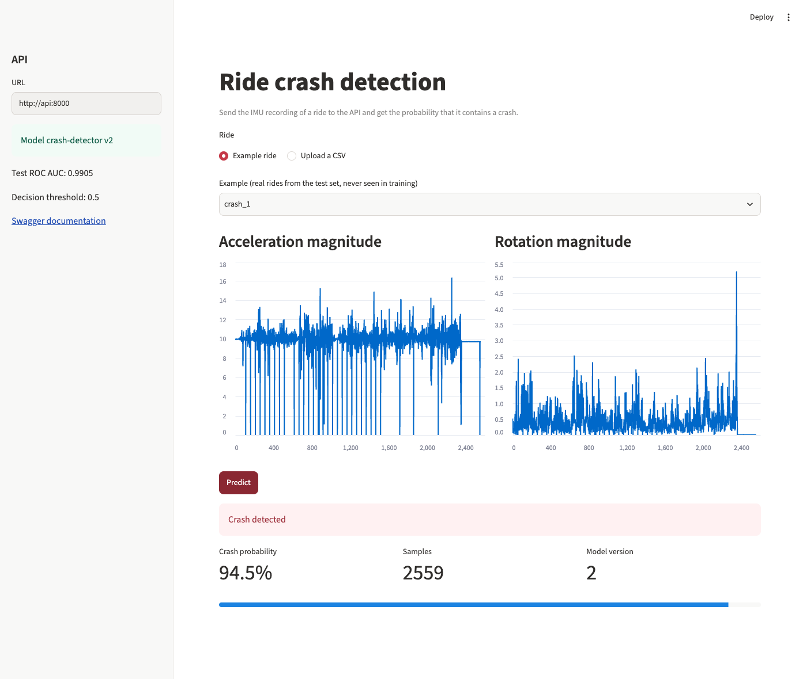
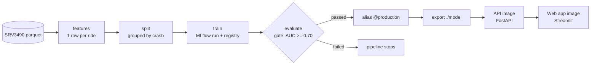
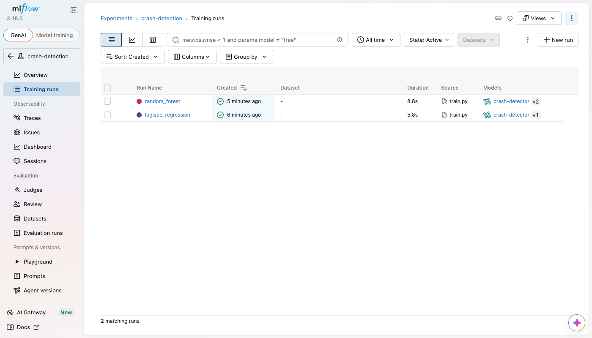
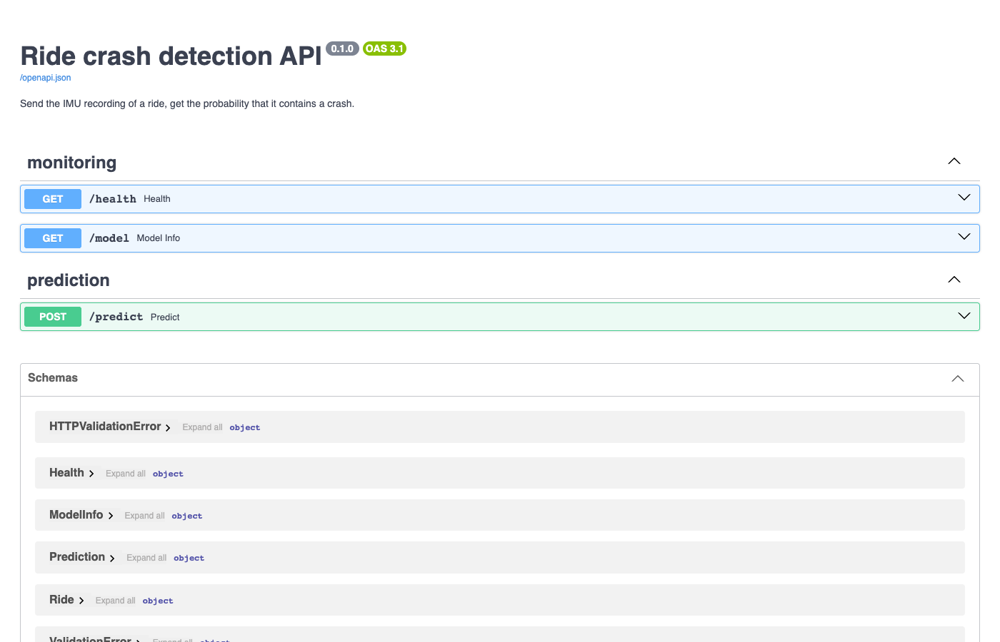

# Ride crash detection — MLOps project

Albert School · MSA-DAT09-01 MLOps & Model Deployment · Group 3

Team: Lou Brunet, Alexis Maeder, Cristian Larrain, Colin Pietri, Mathis Meimoun

Detect whether a micromobility ride contains a **crash (fall)** from the recording of its
motion sensor (IMU: 3-axis accelerometer + 3-axis gyroscope), and ship the model as a product:
reproducible pipeline, experiment tracking, tested API, web app, Docker images and CI/CD.

| | |
|---|---|
| Test ROC AUC | **0.99** (a random model scores 0.50) |
| Test recall / precision | 0.97 / 0.88 at threshold 0.5 |
| API image | [`loubrunet/ride-crash-api`](https://hub.docker.com/r/loubrunet/ride-crash-api) |
| Web app image | [`loubrunet/ride-crash-app`](https://hub.docker.com/r/loubrunet/ride-crash-app) |

## Try it in one command

```bash
docker compose up
```

- Web app: http://localhost:8501
- API documentation (Swagger): http://localhost:8000/docs

The images are pulled from Docker Hub; nothing else is needed.



## The problem

Dataset `SRV3490`: 3,490 rides in 8 European cities, sampled at 10 Hz (16.9 million rows).

- 698 rides contain a user-confirmed crash: the **positive class** (20 %).
- 2,792 baseline rides without any known fall, 4 matched to each crash ride.

One row of the raw file is one sensor sample: `ride_id, crash_ride_id, city, time_index, ax, ay, az, rx, ry, rz, topple`.
A ride is labelled as a crash when `crash_ride_id` is null.

The project archive also contained `GBG500` (reckless-riding detection, 6 positive rides out of 500).
We chose the crash dataset because 698 positives allow a solid evaluation, which is what a
deployment decision needs.

## Architecture



| Brick | Tool | Where |
|---|---|---|
| Dependencies, reproducibility | uv + `uv.lock`, `params.yaml` | `pyproject.toml` |
| Pipeline (DAG) | DVC | `dvc.yaml` |
| Experiment tracking, model registry | MLflow | `src/crashdetect/train.py`, `evaluate.py` |
| API | FastAPI + Swagger | `src/crashdetect/api/` |
| Web app | Streamlit | `app/streamlit_app.py` |
| Tests | pytest | `tests/` |
| CI/CD | GitHub Actions | `.github/workflows/` |
| Packaging | Docker, Docker Compose | `Dockerfile`, `app/Dockerfile` |

## Technical choices

**Features: one row of statistics per ride.** A ride is a time series of about 5,000 samples.
We summarise it with 6 statistics (mean, std, min, max, 1st and 99th percentiles) of 10 signals:
the 6 raw axes, the acceleration and rotation magnitudes, and their sample-to-sample changes.
That gives 62 features. The same function (`ride_features`) runs in training and in the API,
so there is no training/serving skew.

**No label leakage.** The `topple` column marks the fall itself, so it is never read. A test
checks it never becomes a feature.

**Grouped split.** Each crash ride comes with 4 matched baseline rides. They stay on the same
side of the train/test split (and of each cross-validation fold), otherwise the score would be
optimistic.

**Model: random forest**, with median imputation inside the scikit-learn pipeline, so rides with
missing sensor values are still scored. A logistic regression is available as a baseline
(`train.model` in `params.yaml`). Both reach about 0.99 ROC AUC; we keep the random forest for its
slightly better precision at the same recall. The most useful features are the
rotation peaks (`gyr_max`, `rz_max`): a fall makes the vehicle tip over.

**Evaluation gate.** Training only registers a new version. `evaluate.py` scores it on the test
set and gives it the `production` alias only if ROC AUC >= 0.70. If not, the pipeline stops and
no image is built.

**Self-contained API image.** The promoted model is exported from the registry into the image,
so the container needs no MLflow server at runtime.

## Results

Test set: 700 rides never seen in training (140 crashes).

| Model | CV ROC AUC | Test ROC AUC | Test precision | Test recall |
|---|---|---|---|---|
| Logistic regression (baseline) | 0.988 | 0.992 | 0.87 | 0.97 |
| **Random forest (production)** | 0.991 | 0.991 | 0.88 | 0.97 |

MLflow keeps every run with its parameters, metrics, git commit and model version:



The API is documented and testable from Swagger:



## Run it locally

Requirements: [uv](https://docs.astral.sh/uv/), Docker.

```bash
make setup          # install the environment from uv.lock
make test           # unit, integration and API tests
make lint           # ruff
```

To retrain, put `SRV3490.parquet` (from the course `Project.zip`) in `data/raw/`, then:

```bash
make pipeline       # dvc repro: features -> split -> train -> evaluate -> export
make mlflow         # MLflow UI on http://localhost:5000
make api            # API on http://localhost:8000/docs
make app            # web app on http://localhost:8501
```

Without the raw file you can still retrain from the committed features
(`data/processed/features.csv`): `uv run python -m crashdetect.data split && make train evaluate export`.

`make help` lists every command.

## API

| Endpoint | Purpose |
|---|---|
| `GET /health` | Liveness, and whether the model is loaded |
| `GET /model` | Model name, version, decision threshold, test ROC AUC |
| `POST /predict` | Crash probability for one ride |
| `GET /docs` | Swagger UI |

```bash
curl -X POST http://localhost:8000/predict -H "Content-Type: application/json" -d @samples/crash_1.json
```

```json
{"crash_probability": 0.9452, "crash_detected": true, "threshold": 0.5, "n_samples": 2559, "model_version": "2"}
```

The request body holds six lists of the same length (`ax, ay, az, rx, ry, rz`), at least 10
samples; missing values are sent as `null`.

## Tests

| Level | File | What it checks |
|---|---|---|
| Unit | `tests/test_features.py` | Feature values, missing data, stable feature names |
| Integration | `tests/test_pipeline.py` | Data stages, grouped split, MLflow run and registry, gate, export |
| API | `tests/test_api.py` | Endpoints, Swagger, input validation |
| End-to-end | `tests/test_e2e.py` | Real example rides sent to the running Docker container |

Tests run on a small synthetic dataset, so they need neither the raw file nor a trained model.

## CI/CD

- **`ci.yml`** — on every push and pull request: ruff + tests.
- **`cd.yml`** — on `main`: split → train → evaluation gate → export → build both images →
  end-to-end test on the API container → push to Docker Hub (`latest` and commit SHA tags).
  If the gate or the end-to-end test fails, nothing is published.

## Repository layout

```
├── params.yaml              parameters (data, model, gate)
├── dvc.yaml                 pipeline definition
├── src/crashdetect/
│   ├── features.py          ride -> features (shared by training and API)
│   ├── data.py              stages: features, split, samples
│   ├── train.py             training + MLflow tracking and registry
│   ├── evaluate.py          gate + promotion to @production
│   ├── export_model.py      registry -> ./model
│   └── api/                 FastAPI app and schemas
├── app/                     Streamlit web app and its Dockerfile
├── samples/                 4 real test rides (2 crashes, 2 safe) for the demo
├── tests/                   unit, integration, API, end-to-end
└── .github/workflows/       CI and CD
```

## AI infrastructure

Sizing, benchmarks, optimisation (ONNX Runtime, inference threads), distributed-training decision,
scaling and cost plan: see [`ai-infrastructure/`](ai-infrastructure/README.md).

## Limits and next steps

- The model scores a whole ride after it ends; detecting a crash live would need sliding windows.
- Baseline rides are "no known fall", not "certainly no fall": some labels may be wrong.
- Not done: monitoring (Prometheus/Grafana), drift detection across cities, Kubernetes deployment.
