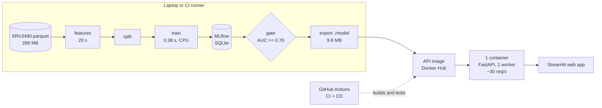

# Current system (what exists and runs today)

| Component | Status |
|---|---|
| Preprocessing, training, evaluation gate | Implemented, run by DVC and by the CD workflow |
| Model versioning | MLflow registry on SQLite, `production` alias |
| Prediction API, web app | Implemented, two public Docker images |
| CI/CD | GitHub Actions: lint, tests, train, gate, build, end-to-end test |
| Where it runs | Local machine and GitHub runners. **No cloud deployment.** |
| Monitoring, autoscaling | **Not implemented** |
