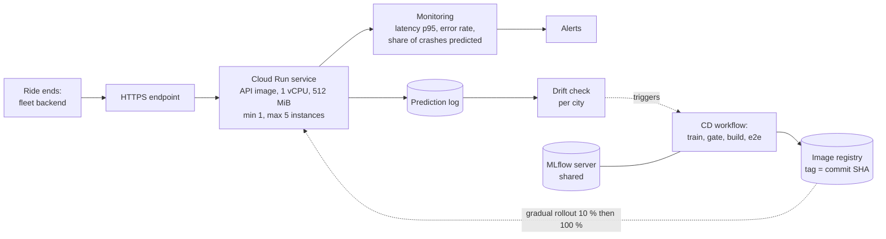

# Proposed system (design, not deployed)

What changes compared to today:

1. The API runs on a managed, autoscaled platform instead of a laptop.
2. Predictions are logged, which makes monitoring and drift detection possible.
3. MLflow moves from a local SQLite file to a shared server.
4. Releases go through a gradual rollout with an instant rollback path.
